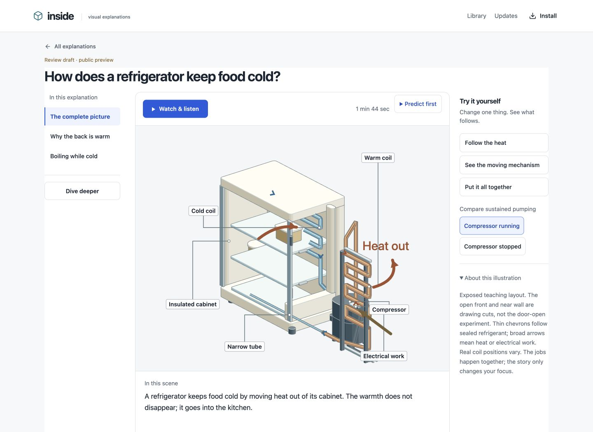
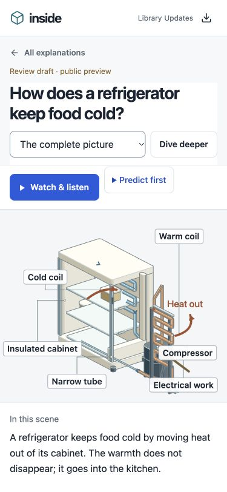
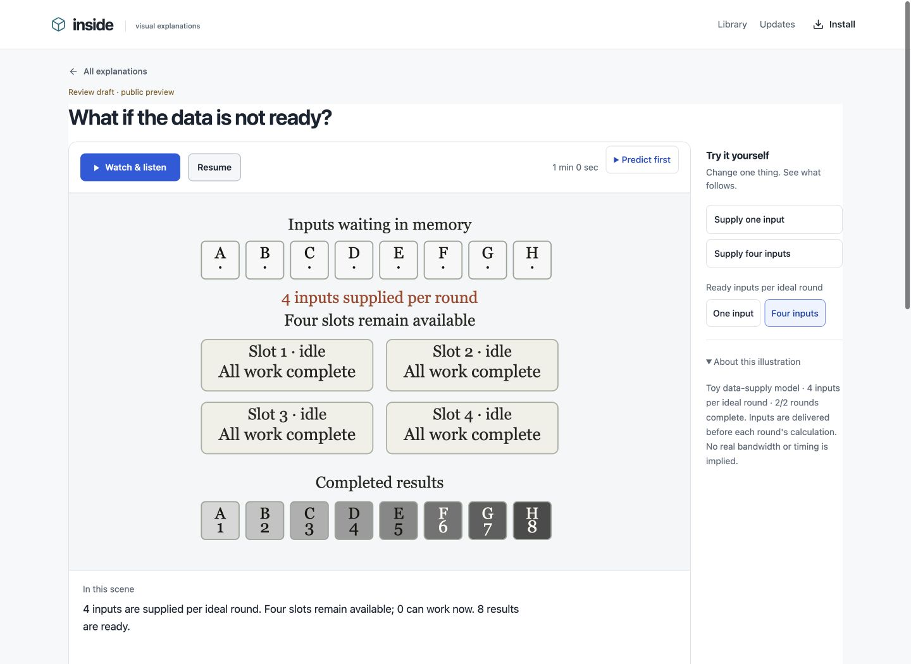

# Inside Machines

Interactive explanations for curious people: see the parts, follow the mechanism,
change one thing and discover why the result changes.

**[Open the live app →](https://inside-machines-alpha.vercel.app)**

No account, invite code or customer API key is required. Start with an everyday
machine or a computing concept, then follow your curiosity into a deeper explanation.



## Explore

- **[How does a refrigerator keep food cold?](https://inside-machines-alpha.vercel.app/#/lesson/refrigerator-r2-core)**
  Follow the heat, inspect the working compressor, then explore why the back is
  warm and how a cold liquid can boil.
- **[Why can GPU work wait for its inputs?](https://inside-machines-alpha.vercel.app/#/lesson/gpu-memory-native-r1)**
  Change data availability and watch which calculations can actually proceed.
- **[Browse the library](https://inside-machines-alpha.vercel.app)**
  Twenty everyday-system scopes include cars, microwaves, washers, vacuum cleaners,
  air conditioners, pressure cookers, fans, water heaters and kitchen plumbing.

Watch with narration or explore silently. Make a prediction, try a comparison,
ask a follow-up, leave feedback or save a complete path offline. Missing-subject
requests collect interest; they do not start paid generation.

<p>
  
  
</p>

## Status

The web/PWA framework is implemented: shared playback, progressive depth,
narration/captions, experiments, offline paths, feedback, private browser
conversations, topic requests and owner production/review tools.

This is a **public learning preview**. The source-authored refrigerator and GPU
examples demonstrate the native production path. Sixteen older schematic cores
still need the same level of visual craft. Independent technical review,
actual-device accessibility and beginner teach-back/transfer studies are
unfinished. Engineering tests do not certify these outcomes.

Public preview permission is separate from quality acceptance. Draft labels remain
visible; no human review result is invented to make an explanation accessible.
See the [quality bar](docs/QUALITY-BAR.md) and [current progress](PROGRESS.yaml).

## How it works

A complete causal story comes first; optional insight and model views follow.
Physical machines use connected parts; computation uses actual data and operations.
Both share the same player and versioned contracts.

The selected visual direction is **Claude + [Anatomy](https://github.com/wheresryan22/anatomy)**.
Trusted source modules supply artwork, narration cues and video checkpoints.
A finite registry binds exact source, lesson and media identities. Visitors cannot
supply executable artwork, and earlier revisions remain readable.

Playback does not call a model. Local exports can use computer narration without
a paid API call. Optional live chat uses server-side credentials and a spending
cap. Owner AI production has explicit reservations, checkpoints and usage receipts;
there is no automatic paid retry or provider fallback.

OpenAI and Anthropic adapters use the shared model gateway. Research, authoring,
editorial review, chat and speech are separately routed. The native Claude/Anatomy
workflow and older structured schematic pipeline are distinct production formats.

| Location | Purpose |
| --- | --- |
| `web/studio/` | Shared player, depth navigation, narration clock and design tokens |
| `backend/` | API, sessions, discussions, requests, budgets and review rules |
| `native/` | Trusted registry, source verification and artifact export |
| `experiments/refrigerator-study/r2/` | Physical artwork and semantic lesson metadata |
| `docs/` and `design/lessons/` | Product decisions, claim ledgers and teaching rubrics |

## Run locally

Use Node 24 and Python 3.13. Anatomy and the shared runtime are included as pinned
or vendored dependencies; the author's private workspace is not required.

```sh
git clone --recurse-submodules https://github.com/chintan-projects/inside-machines.git
cd inside-machines
uv venv .venv --python 3.13
uv pip install --python .venv/bin/python -r requirements.txt
npm ci
cp -n .env.example .env.local
```

Set `INSIDE_PUBLIC_ACCESS=true` and unique random `INSIDE_SESSION_SECRET` and
`INSIDE_OWNER_CODE` values in `.env.local`. Keep the owner code private and
`INSIDE_BUDGET_USD=0` to disable paid calls. Preserve an existing environment file.
Provider keys belong on the server, never in `VITE_` variables.

```sh
npm run build
# macOS: prepare three local starters with computer narration.
.venv/bin/python -m backend.seed
npm start
```

Open [localhost:8000](http://127.0.0.1:8000). For frontend development,
`npm run dev` serves port 5173 and proxies the API to port 8000. SQLite is used locally;
production uses Postgres and private Blob storage. A fresh clone contains neither
the production database nor generated videos or anyone's conversations.

See [native production](docs/NATIVE-VISUAL-PRODUCTION.md) for source-authored
exports and explicit preview/release operations. Native iOS/Android clients are
not implemented; the versioned API and artifacts support that future work.

## Verify changes

Install the developer tools (`ruff`, `mypy`, `pytest`, `pytest-asyncio`,
`pytest-cov`, `types-PyYAML` and `types-Pillow`) in the same Python environment.

```sh
.venv/bin/ruff check backend main.py tests
.venv/bin/mypy --strict backend main.py tests/backend
.venv/bin/pytest --cov=backend --cov-fail-under=80
npm run check:types
npm run lint
npm test
npm run build
```

The build checks native source/spec identities and Vercel upload traversal.
Transactional changes use disposable Postgres regressions. Deployment checks
cover Linux dependencies, private-input exclusions, the durable queue and CDN/
offline assets. See [verification](docs/VERIFICATION.md).

## Guides and credits

- [Concept explanation spec](docs/CONCEPT-EXPLANATION-SPEC.md) and
  [iteration worksheet](docs/templates/lesson-iteration.md): visual reasoning,
  plain causal language, predictions and transfer checks.
- [Native artifacts](docs/architecture-decisions/0007-native-visual-artifacts.md),
  [curated requests](docs/architecture-decisions/0006-curated-library-and-interest.md)
  and [progressive paths](docs/architecture-decisions/0004-progressive-learning-paths.md).
- [PRD](docs/PRD.md), [mobile path](docs/MOBILE-PATH.md) and
  [Claude authoring](docs/CLAUDE-AUTHORING.md).

Anatomy is pinned to `1482e8469b0a9e0d8cc18ea2740a01423d29ae80`; its
[MIT notice](vendor/anatomy/LICENSE) is preserved and shipped with the app.
The bundled Inter font retains its [OFL notice](public/fonts/OFL.txt).
Grant Sanderson, Richard Feynman and Veritasium inform the explanation practices;
no endorsement is implied.
