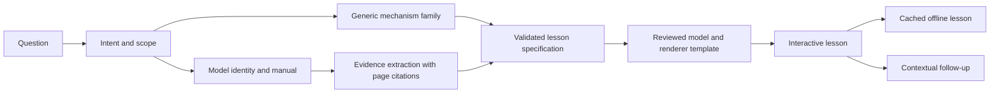

# Can this become a machine-explainer PWA?

The follow-up [product requirements](docs/PRD.md), [competitive research](docs/MARKET-RESEARCH.md), and [iOS and business-model assessment](docs/IOS-AND-BUSINESS-MODEL.md) refine this initial technical exploration. They prioritize a personal learning pilot before a hosted generation service.

Yes. The useful starting product is an interactive lesson that answers a specific mechanical question. The difficult work is reliable explanation, grounded model-specific facts, and generated-figure quality. The PWA shell is straightforward by comparison.

## What I inspected

1. [wheresryan22/anatomy](https://github.com/wheresryan22/anatomy): README, skill workflow, drawing primitives, reference API, browser scripts, license, and the dial-indicator build example. Local snapshot: `1482e8469b0a9e0d8cc18ea2740a01423d29ae80`, inspected October 19, 2026.
2. [Elvar's linked X post](https://x.com/elvar_official/status/2111831136171151589), linking the article “How I Turn Any Question Into a Machine You Can Run,” dated October 18, 2026. Direct X fetching failed. I recovered the article body and embedded prompt text through the [FxTwitter mirror endpoint](https://api.fxtwitter.com/elvar_official/status/2111831136171151589). This is mirrored text; I did not verify the original embedded videos or benchmark the author's time claims.
3. [Official OpenAI tools documentation](https://developers.openai.com/api/docs/guides/tools) and [Structured Outputs documentation](https://developers.openai.com/api/docs/guides/structured-outputs).
4. [Whirlpool's general cycle explanation](https://www.whirlpool.com/blog/washers-and-dryers/how-does-a-washing-machine-work.html) for wash, drain, rinse, spin, and the distinction between front-load tumbling and top-load agitation. It does not supply this demo's illustrative numbers or establish an exact machine design.

## Anatomy: what it gives us

Anatomy is an agent skill and a rendering/verification kit. It contains instructions, isometric drawing primitives, standalone HTML examples, React helpers, optional WebGL effects and experimental 3D motion, plus browser and geometry checks. It is not a hosted prompt-to-machine API, appliance database, conversational backend, or physical simulator.

The repository explicitly documents Codex, alongside Claude Code and several other coding agents. The kit uses ordinary JavaScript/TypeScript, SVG, and optional WebGL. Its geometry and built pages have no dependency on Anthropic. The base Node builders use built-in modules; React components require React. Chrome/Chromium is needed for its browser checks. The MIT license is included in the local build.

That proves portability of the tooling, not equal visual quality or generation time across models. Browser iteration and criticism are part of the workflow, not optional consequences of writing a good prompt. A renderer that produces a clear washer once is different from a service that produces any accurate machine on demand.

## What the article contributes

The author's pattern is a recognizable machine, an exposed mechanism, a sequence of actions, short explanations, and readings driven by one small model. It also describes manual/automatic playback, visible time scaling, browser review, and an optional deterministic video-export pipeline.

This is a useful authoring approach. The local prototype tests that approach with Codex and Anatomy. It does not establish that the author's reported build time or quality will generalize to arbitrary objects. A shared model prevents the drawing and readouts from contradicting each other; it does not establish that the model itself matches reality.

## The product decision

At this exploratory stage, start with the person who has a concrete curiosity: “Why does my washer spin so much faster at the end?” Give them a moving cause and a visible consequence. The success test is whether they can explain the mechanism or predict what happens next after using it.

An empty prompt promising every machine raises two expectations immediately: instant output and exactness. Both are harder than the rendering demo suggests. My recommendation is to start with a small set of reviewed mechanism families and let AI choose and explain the right one. Add custom generation after measuring factual quality, rendering failures, and actual latency.

The first validation should compare the interactive washer lesson with a short text answer. Ask users to explain why slow tumbling and fast spinning do different jobs. Observe whether they use the controls and whether their explanation improves. If the cutaway is merely attractive, more generated machines will not solve that problem.

## The generic/specific flow

| User intent | App behavior |
| --- | --- |
| “How does a washing machine work?” | Open a generic lesson immediately. State the chosen family, such as front load; offer top load as an alternative. No model number required. |
| “How does my washing machine work?” | Ask a single scope question: understand the principles, or match the user's machine? |
| “Just the principles” | Continue with the generic lesson immediately. |
| “Match my machine” | Ask for brand/model, a nameplate photo, or an owner manual. Show the detected identity and ask the user to correct ambiguous matches. |
| Evidence establishes only some details | Adapt only supported properties; attach a source/page to each property. Keep the remaining geometry and behavior explicitly generic. |
| Manual/model missing or conflicting | Offer the generic lesson and say which details remain unresolved. Do not fill missing appliance specifications with guesses. |

Model matching is more than recognizing the brand. A pump-driven espresso machine and a spring-lever machine have different sources of pressure. Front-load and top-load washers have different wash actions. Refrigerator compressor arrangements and refrigerants vary. A kitchen's plumbing layout also needs local evidence if the explanation is meant to represent that home.

## OpenAI implementation

There are three separate roles:

| Role | Recommended use |
| --- | --- |
| Codex during development | Read Anatomy instructions, write model/geometry/UI code, run a build, and inspect browser results. This prototype is direct evidence that the kit can be used in Codex. |
| OpenAI API in the product | Interpret requests, identify the mechanism family, extract evidence, produce a lesson specification, and answer follow-ups. The Responses API supports tools; Structured Outputs can constrain a response to a lesson schema. |
| Browser | Render SVG/WebGL and run a deterministic model. It should continue to work when the AI request is over and when a saved lesson is offline. |

API schema adherence does not guarantee factual correctness. Validate the generated specification against known mechanism rules and require sources for model-specific assertions. Pick the production model with a small quality/latency evaluation rather than assuming the development agent's model is the only suitable choice.

The repository's lack of a required API key refers to the drawing kit/local agent workflow. It does not provide a hosted inference service for an independently deployed app. No Anthropic or OpenAI API call was needed for this bounded local artifact; this Codex session authored the code. The runtime AI integration remains to be built and tested with credentials.

## Proposed architecture

Keep a small PWA frontend, a server endpoint holding provider credentials, and a versioned lesson library. The server turns the question plus optional evidence into structured data: mechanism family, known identity, assumptions, parts, steps, parameters with units and provenance, explanation focus, and source references. Validate this data and render it using reviewed templates. The frontend never receives an API secret.

For a first public version, support one generic family per machine category, plus clearly bounded model-specific annotations. Cache the result by mechanism/model identity, evidence revision, template version, language, and requested explanation depth. Store completed lessons for offline viewing; new AI generation still needs connectivity.

For novel mechanisms, use an asynchronous build worker: research, write the pure model, generate geometry in a restricted workspace, build, check invariants, render multiple poses, inspect screenshots, repair, and publish only a passing artifact. Give the user honest progress and failure states. Never evaluate returned JavaScript in the main app origin; arbitrary generated code needs an isolated execution/rendering boundary. Treat uploaded manuals as source material, not instructions.

The follow-up experience should be tied to the current part, stage, and evidence. “Why does it need a pump?” can highlight the drain path. “What if the valve stayed open?” should change a reviewed scenario with declared assumptions, rather than letting an LLM invent new physics on every animation frame.

## Practical sequence

1. **Local proof, completed here:** one generic washer lesson, shared state model, intake distinction, working browser controls, phone layout, offline cache.
2. **First API slice:** interpret requests into a validated washer lesson specification, answer source-linked follow-ups, and extract model details from a supplied manual. Measure correctness and latency. Keep the current template as the renderer.
3. **Small lesson library:** add espresso, refrigerator, and kitchen sink plumbing after choosing the exact mechanism family and verifying each explanatory model. Reuse the player and intake flow.
4. **PWA product:** saved lessons, camera/manual input, evidence management, install testing on target devices, generation job states, server persistence, and provider usage limits.
5. **Broader generation:** build and evaluate the isolated artifact worker. Deterministic video export can follow from the same timeline; it is not required for the core learning experience.

No cost, quality score, or arbitrary-generation latency is established by this local experiment. Measure those after a real API slice. Generic lessons and exact digital representations should have distinct quality bars.

## Validation performed

- Deterministic model tests: bounded water, drain-before-spin ordering, pump/interlock behavior during high speed, stop/release at completion, finite poses, clamped inputs, and continuity across stage boundaries.
- Chrome: play/pause, stage seeking and all five stage readouts, specific-machine intake and explicit unverified status, unsupported-machine message, and clean console.
- Desktop at 1440 px and phone layout at 390 px: screenshots inspected; no horizontal overflow.
- Reduced-motion media setting: flow animation disabled and stage seeking functional.
- Service worker: all nine shell assets cached, network forced offline, page reloaded, and the spin lesson remained functional.
- Visual review: five-stage contact sheet and mechanism closeup. Changed the roof to expose the inlet and adjusted motion scaling for legibility.

Not validated: exact-appliance accuracy, fluid/fabric physics, full Anatomy collision/clearance audit, API-backed generation, video export, screen-reader audit, native PWA installation, or real-device/cross-browser behavior.
