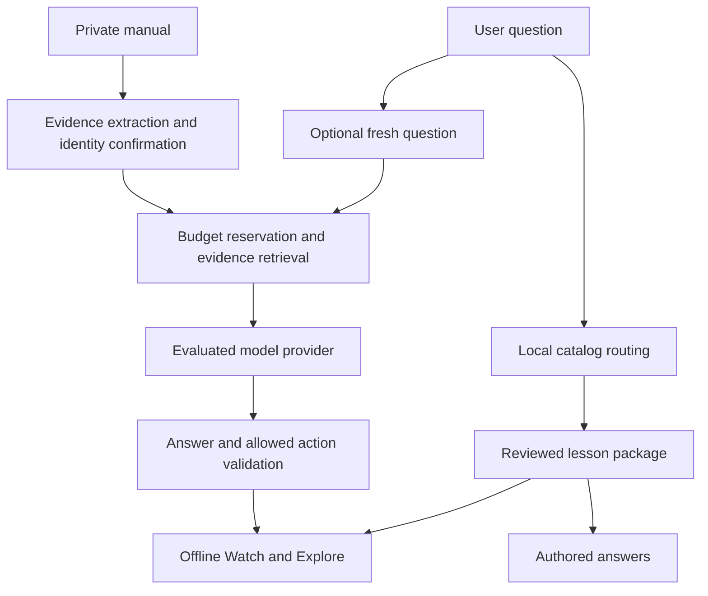

# Inside visual concept explainer product requirements

## 19 October scope extension: computing concepts

The owner requires the teaching framework to transfer to GPUs, LLMs and later
concepts. Reuse lesson packages, playback, evidence, assessment, offline/media,
private chat, provider routing, budget and quality gates. Specialize representation
and causal rules per domain: physical cutaways for appliances, execution/dependency
views for GPUs, and token/representation/generation views for a bounded LLM scope.
[ADR 0003](architecture-decisions/0003-extensible-concept-lessons.md) governs this
extension. GPU and LLM worksheets and fixed evaluation cases are planning/engineering
evidence; their actual lessons, paid quality comparisons and human acceptance are
pending. Broad topic coverage is not promised by a guide entry. Earlier physical
alpha sequencing below remains dated context, not an assumption baked into the engine.

**Active concept-explanation decision:** [ADR 0001](architecture-decisions/0001-concept-explanation.md)
and the [teaching spec](CONCEPT-EXPLANATION-SPEC.md) govern explanation quality and
subsequent implementation. Lessons build a causal mental model through a concrete
question, prediction, observation, explanation, system recombination and transfer.
Use the [AC benchmark](../design/lessons/air-conditioner.md) before expanding the
craft claim to other machines or generated content. Its formative acceptance test
complements the later comparative pilot below; neither has been completed.

**Active family-alpha addendum:** The user's later request moves shared on-demand creation into the first hosted alpha: look up first, generate a missing generic lesson with both interactive and narrated-video outputs, then reuse it for others. Family invites, private follow-up chat, thumbs/reasons, demand analytics and an explicit AI ceiling are included. Three authored lessons are a starting library rather than a catalog limit. The [current build plan](BUILD-PLAN.md) controls this revised delivery target; the release sequence below preserves the original product rationale. Exact-model document ingestion and native store releases remain later stages. Installed web use supports explicit lesson downloads; an uninstalled app still needs its initial network visit and invite.

Version 1.0 draft for product decisions. October 19, 2026. Product owner: Chintan. Stage: exploration. Initial delivery: personal local pilot, followed by an optional consumer release.

Inside helps a curious person understand a physical mechanism by seeing the relevant parts act together. Start with three reviewed lessons that work without runtime AI. Add bounded, source-aware questions as an experiment. Expand to ten lessons and an iOS product only after demonstrating useful learning and repeat demand.

The product must remain worthwhile if no subscription business emerges. A personal library is a valid outcome. Monetization is an option to test, not a condition that drives the first learning experience.

Related decisions: [market research](MARKET-RESEARCH.md), [iOS and business model](IOS-AND-BUSINESS-MODEL.md), [cost scenarios](COST-TABLES.md), [design brief](../BRIEF.md), and [design direction](../DESIGN.md).

## Product decision

Build a small library of interactive machine explanations with a guided Watch mode. Use code-driven scenes so that people can pause, inspect a part, and try one meaningful variable. Produce video versions from those same scenes when passive viewing or distribution calls for them. Do not regenerate a movie merely because another person asks the same question.

The proposed distinction is a short path from a real question to a visible causal answer, with reliable treatment of exact-machine evidence. Broad topic coverage, photorealistic 3D, a social feed, and instant generation of any object are deliberately outside the first release.

Three principles govern this choice. Learning must improve beyond what an attractive video already provides. Generic mechanisms should be reusable across people. Personalization should change the explanation only when a documented difference warrants it. These principles direct investment toward explanation quality, reusable content, and evidence handling.

## Problem and first audience

The first user is an adult who has encountered an everyday machine, asked a concrete “why” or “how” question, and wants the mechanism to make sense without studying a manual or engineering vocabulary. Examples include “Why does the washer spin so fast at the end?”, “Where does espresso pressure come from?”, and “How can a refrigerator move heat into a warmer room?”

At that moment the user is curious, sometimes mildly frustrated, and uncertain whether a general explanation applies to their appliance. They want a useful mental picture quickly. They are not necessarily motivated to install a new app, subscribe, identify a model, or study ten other machines. Those are costs the product must earn.

The primary job is: **When I cannot picture how a familiar machine produces its result, help me see the cause and effect so I can explain it or predict a related behavior.**

| Segment by immediate need | Priority | Product consequence |
| --- | --- | --- |
| A concrete causal question about a familiar machine | First | Direct lesson entry and question-specific highlights |
| Understanding a machine the person owns | Second | Optional identification and evidence-linked differences |
| Explaining a mechanism to another adult | Later | Shareable generic lesson and a concise Watch mode |
| Curriculum learning or teaching children | Deferred | No school administration, child profiles, or classroom promises |
| Diagnosing a fault or carrying out a repair | Outside current scope | Identify that intent and point toward appropriate manuals/support rather than present a generic scene as diagnosis |

## Evidence and assumptions

The local prototype establishes that Codex and Anatomy can produce one controllable washer lesson. It has a deterministic teaching model, responsive presentation, and offline reload. It does not establish engineering accuracy, broad generation, user demand, willingness to pay, or production cost. Its illustrated numbers and placements remain schematic.

The market already includes a [15-machine interactive catalog](https://visual-learning.app/), [interactive educational simulations](https://phetsims.colorado.edu/en/about), and [general-assistant visual explanations](https://academy.claude.com/use-cases/visualize-the-mechanism-behind-an-explanation-mid-chat). The opportunity therefore depends on a better experience for the chosen question, not simply having animation. See the market report for source observations and limits.

| Hypothesis | What would support it | What would change the plan |
| --- | --- | --- |
| Manipulating the mechanism improves understanding | Better transfer answers than the participant's current explanation source | Equivalent learning with substantially more friction favors simpler video/text delivery |
| People have further real questions | Unprompted second questions and return use | One-off entertainment favors a finite collection over a subscription |
| Specific-machine context adds value | Verified differences change a step, component, or answer | Cosmetic changes alone defer model matching |
| Reviewed templates cover early demand | At least 80% of supported pilot questions route to an existing mechanism/answer | Frequent unrelated questions require a different audience or content strategy |
| Hosted questions can stay inexpensive | Accepted answers meet quality and cost limits simultaneously | Quality requires expensive work on most questions; reduce scope or charge separately |

All numerical gates below are proposed pilot decisions. They are not measured results or industry benchmarks.

## Scope and release sequence

| Release | Required outcome | Included | Excluded |
| --- | --- | --- | --- |
| S0 personal learning pilot | Three lessons teach useful mechanisms | Reviewed content, Watch/Explore, one variable per lesson, curated questions, offline playback, feedback | Accounts, billing, free-form runtime AI, exact-machine claims |
| S1 bounded questions pilot | Fresh questions receive grounded answers within budget | Hosted/on-device evaluation, cited follow-ups, typed model identity, pasted excerpt or one PDF, evidence states | Arbitrary scene generation, automatic manufacturer equivalence, unlimited chat |
| S2 optional consumer release | Ten useful lessons and a credible reason to return | Expanded catalog, supported iOS delivery, downloads, optional finite pack purchase, purchase restoration if sold | Subscription unless return-use evidence supports it |
| S3 custom explanations experiment | New artifacts pass quality and cost gates | Asynchronous bounded authoring, isolated rendering, review, quoted credits if monetized | Instant unreviewed public generation |

Sequence is governed by evidence, not an invented delivery date. Development estimates follow a technical spike and content-review capacity assessment. The existing app remains a prototype; this PRD does not imply S0 is complete.

## Initial content

Pilot with the washer, a pump-driven espresso machine, and a vapor-compression refrigerator. These cover liquid flow, pressure, mechanical movement, and heat transfer while testing reuse across different mechanisms. The current washer needs content and mechanical review before becoming a released lesson.

| Candidate lesson | One question it must answer | One useful interaction | Content boundary |
| --- | --- | --- | --- |
| Front-load washing machine | Why tumble slowly and then spin fast? | Change drum speed and observe the stated clothing-motion regime | Generic family; real cycle timing varies |
| Pump-driven espresso machine | What creates pressure and what resists the flow? | Compare reviewed flow-resistance scenarios | Educational relationships; no exact brew prediction without validated parameters |
| Vapor-compression refrigerator | How does it move heat out? | Trace energy transfer around the cycle | No model-specific refrigerant or service claims |
| Top-load washer | How does its wash action differ? | Compare agitator and impeller concepts where reviewed | Separate mechanisms, not a front-loader reskin |
| Spring-lever espresso machine | How does a spring produce brew pressure? | Change a reviewed spring/piston parameter | Separate from pump-driven architecture |
| Dishwasher | How do recirculation and draining differ? | Follow water during wash versus drain | Filter, heater, and pump layouts vary |
| Kitchen sink trap | Why does water remain in the bend? | Compare a full and depleted trap seal | Generic plumbing; venting/layout vary |
| Electric toaster | What converts electricity into heat? | Inspect a reviewed heating/control sequence | No live electrical servicing instructions |
| Electric kettle | What stops heating at boiling? | Trace the supported cutoff mechanism | Cutoff mechanisms vary by design |
| Toilet cistern | How does refill stop after a flush? | Move the float through a reviewed valve sequence | Specify the cistern/valve family |

The remaining seven are candidates for S2, not a production commitment based on count alone. Replace topics with observed user questions. Each lesson requires original or licensed content, sources, a misconception to address, a transfer question, a text alternative, and review ownership.

## Core journeys

### Open an existing explanation

The home screen offers a small visible set of machines and a question field with examples. A direct link opens its lesson immediately. Browsing and the first useful playback require no account or API key. When the user chooses a known generic machine, the app displays the chosen family with a Change type control instead of asking for an unnecessary model number.

Watch presents a 60–120 second authored overview, with visible pause and stage controls. Explore lets the person tap a part and change one reviewed variable. Switching between them preserves progress and the selected mechanism. The learning moment is the visible consequence of changing a cause, not a decorative introduction.

### Ask about a machine

“How does a washing machine work?” opens the generic front-load family, labeled as such. “My washing machine” prompts once: “Understand the principles” or “Match my machine.” Ambiguous named models with an obvious mechanism can still open a clearly generic lesson while offering identification. Ask a question only if its answer changes the explanation or prevents a misleading match.

Unsupported topics show the closest relevant existing lesson where appropriate, with a clear reason it differs. Offer an optional topic request. Do not animate a fake generation process or spend a paid generation allowance on an unsupported question.

### Identify a specific machine

In S1, accept brand/model and an optional manual PDF or excerpt. Photo/nameplate scanning is a later convenience. The user confirms any ambiguous identity. Match a mechanism family before adapting details. Model identity, verified behavior, and schematic geometry have separate statuses.

A successful model match does not certify internal geometry. An owner manual may establish operating steps while saying nothing about pump placement or internal pressure. Each factual change needs a source and locator. Where evidence is insufficient, retain the generic mechanism with a nearby explanation of what remains generic.

### Ask a follow-up

Keep the current part, stage, and the user's confusion as context. Authored questions work offline without inference. For a fresh S1 question, retrieve only relevant lesson/manual evidence, answer briefly, and invoke a supported visual action such as highlighting a part or seeking a stage. A model may select validated actions; it may not invent a new physical simulation or alter verified parameters.

If no grounded answer is available, explain the missing fact and offer the relevant generic explanation or a source request. Budget exhaustion leaves playback and authored questions working.

### Return offline

Installed/bundled lessons open offline. Downloaded lessons show their size, availability, and version. Saved progress and bookmarks remain local in S0. Fresh hosted questions explain that connectivity is required; they are not silently queued for paid work. Returning online does not automatically restart a charged job.

## Functional requirements

Priorities are release-specific. “Must” requirements block the release named in the row.

| ID | Release | Requirement | Acceptance evidence |
| --- | --- | --- | --- |
| F01 | S0 | Open a catalog lesson or direct lesson link without sign-in | A new user reaches playback without an account or model credential |
| F02 | S0 | Show machine family and schematic status | Front-load versus top-load and pump versus lever are distinguishable before playback |
| F03 | S0 | Support Watch, pause, resume, restart, stage jump, and scrub | Seek and playback at the same time produce equivalent model state and readouts |
| F04 | S0 | Inspect parts and change one meaningful reviewed variable | Control changes an explained consequence; all affected views/readings agree |
| F05 | S0 | Provide short stage text and an accessible text lesson | The mechanism is understandable without motion, sound, or color alone |
| F06 | S0 | Provide at least three authored questions per lesson | Questions work offline and seek/highlight an appropriate part or stage |
| F07 | S0 | Provide a transfer question | Correct reasoning is defined before testing; answer disclosure follows the user's attempt |
| F08 | S0 | Show sources and assumptions | Every numerical or model-specific assertion maps to evidence or an illustrative label |
| F09 | S0 | Handle unsupported and ambiguous questions honestly | No unsupported input is presented as a successfully generated exact machine |
| F10 | S0 | Save local progress, bookmarks, and download state | Closing/reopening restores state; a reset clears it without corrupting a lesson |
| F11 | S0 | Support bundled/offline playback | First-launch bundled lessons run in airplane mode; unavailable downloads do not masquerade as saved |
| F12 | S0 | Offer feedback on the confusing stage | Record lesson/version/stage with consent; private text is not sent in background analytics |
| F13 | S1 | Ask scope once and permit generic learning immediately | Specific-machine intake can be skipped or reversed without losing playback |
| F14 | S1 | Ingest a model identity plus excerpt or one supported PDF | Pilot limit: 20 MB/100 pages; corrupt, encrypted, image-only, and oversized files have distinct recovery paths |
| F15 | S1 | Preserve evidence and uncertainty per claim | Verified annotation opens its document/page or excerpt; unsupported layout stays schematic |
| F16 | S1 | Answer fresh questions using bounded evidence and allowed visual actions | Evaluation checks factual support, relevance, visual action validity, and cost |
| F17 | S1 | Enforce usage budgets before dispatch | Parallel/repeated requests cannot bypass reservations or duplicate charges |
| F18 | S1 | Provide private-data controls | Delete manual, extracted claims, derived private answers, and indexes; show completion or unresolved deletion |
| F19 | S2 | Deliver equivalent core learning on supported iPhones | Real-device acceptance covers offline use, Dynamic Type, VoiceOver, interruption, thermal behavior, and safe areas |
| F20 | S2 if sold | Sell a defined pack and restore entitlement | Purchase, pending, cancellation, refund/revocation, offline use, and restore paths are tested |
| F21 | S3 | Quote and run new-artifact jobs with explicit limits | User sees deliverable, maximum credit charge, state, and failure policy before dispatch |
| F22 | S3 | Reconcile job failures and reconnects | One logical job settles at most once; failed delivery returns reserved credits under the published policy |

## Model and content integrity

A lesson package has an immutable ID and version, mechanism family, supported questions, parts, parameter definitions with units/ranges, stage definitions, a pure state model, rendering assets, text alternatives, curated answers, sources, review status, and change history. Artifacts must declare whether time, speed, size, or geometry are scaled.

Keep three evidence states explicit: **reviewed generic mechanism**, **documented model detail**, and **unverified information**. User-provided statements begin unverified. AI output never upgrades its own status merely because it is confident. A generic asset with verified annotations remains a generic asset; it does not become an exact digital twin.

For every accepted lesson, review physical direction, conservation relationships relevant to the explanation, timing/units, component roles, and likely misconceptions. Numerical displays and motion must derive from the same declared state. Use invariant tests where they establish real behavior; visual agreement alone cannot validate the model.

The standard is explanatory accuracy at the declared level of simplification. Realistic-looking detail that falsely implies an exact placement should be removed or marked schematic. One lesson does not need to depict every bolt to answer its question.

## Interaction and design requirements

Person: an adult with a concrete mechanism question. Job: make the relevant cause and consequence visible quickly. Posture: calm, precise, hands-on. References: [Ciechanowski's engine](https://ciechanow.ski/internal-combustion-engine/) for variable-to-mechanism connection, and [Tinybop](https://tinybop.com/apps/simple-machines) for direct manipulation and discovery. Do not copy their content.

Ranked choices:

1. Open the mechanism before asking for personal setup.
2. Spend visual detail on the part that explains the question.
3. Preserve a useful offline experience when intelligence is unavailable.
4. Treat documented differences as annotations until evidence justifies a different mechanism.
5. Keep paid computation explicit while repeat learning stays frictionless.

The first lesson viewport must contain a recognizable machine, one useful control, and the question being answered. Avoid the prototype's large introductory marketing area for returning users and direct links. Use progressive detail: motion first at a useful scale, then part explanation, evidence, and numerical depth as needed.

Motion explains physical behavior. Ambient loops do not compete for attention. Respect reduced motion with static stage poses and explicit progression; make full-motion playback a deliberate user choice. Never rely on hover. Touch targets should be at least 44 by 44 points on iOS. Provide meaningful focus, labels, contrast, text scaling, captions for narration, and nonvisual equivalents for scene changes. See [DESIGN.md](../DESIGN.md) for proposed tokens and interaction direction.

## Required states

| Surface | States that must be designed |
| --- | --- |
| Catalog/search | Ready, no match, ambiguous family, offline, unavailable lesson |
| Player | Paused, playing, complete, reduced motion, lost focus/background, renderer unavailable |
| Downloads | Not saved, size confirmation, downloading, interrupted, saved, outdated, removed |
| Identity/evidence | No identity, candidate match, confirmation needed, matched identity, partial evidence, conflict, unsupported file, deletion |
| Fresh answer | Ready, waiting, streaming if supported, grounded answer, missing evidence, provider unavailable, offline, budget limit |
| Purchase if enabled | Not purchased, pending, complete, canceled, failed, restored, revoked/refunded, offline entitlement |
| New artifact in S3 | Quoted, reserved, queued, researching, building, checking, review required, complete, failed, canceled, settled |

Every error tells the person what happened, what they can do now, and what remains available. Do not use an invented percentage or completion promise when the system cannot measure it.

## Architecture and model routing

Use shared content packages and a deterministic renderer across PWA and iOS. Evaluate an iOS shell with packaged web scenes before committing to a renderer rewrite. Native features should serve the learning job: reliable downloads, accessibility, camera/document input when introduced, and purchases if sold.

AI is an optional service boundary. A small catalog can route locally. Compare on-device, Apple-hosted where eligible, and external hosted options on the same test set. Use a provider abstraction but implement only the winning path first. The consumer should never choose a frontier model to understand a washer.

External hosted secrets remain on a backend. The backend limits context, retrieves evidence, reserves costs, calls a model, validates its answer/actions, and records usage. Runtime rendering uses reviewed assets; no model-produced JavaScript runs in the main app context. New code generation belongs in a separate S3 build environment with restricted capabilities and review before distribution. [OpenAI authentication guidance](https://developers.openai.com/api/reference/overview).

The shared public cache key includes mechanism, lesson/template version, language, and explanation focus. Personalized manual answers use an owner-scoped cache and evidence revision. Private content must never enter public cache reuse merely to lower cost. Invalidated sources invalidate dependent answers.

## Privacy and operating requirements

S0 stores progress locally and requires no cloud account. S1 sends only the context needed for an explicitly requested answer; disclose the selected processing service before the first upload. Strip unnecessary document metadata and nameplate identifiers where possible. File names, manuals, photos, serial numbers, and raw questions stay out of general analytics and error logs.

Default S1 proposal: process manuals privately, delete raw uploads after 24 hours unless the person chooses to retain them in their library, and retain derived evidence only while the user keeps that machine. Let the user delete earlier. Verify deletion across object storage, extraction indexes, and caches; document backup-retention behavior before a public release. No reuse for a public library without a separate rights and consent decision.

Separate app-budget telemetry from content: token counts, provider, cost estimate/actual, latency, job status, error category, and lesson/version identifiers are sufficient for most operational questions. A diagnostic opt-in must be separate from basic use.

## Performance and accessibility targets

Targets apply to a declared supported-device matrix selected during S0, not every device.

| Measure | Proposed target | How to check |
| --- | --- | --- |
| Bundled lesson to first usable frame | p95 under 2 seconds, warm or cold state reported separately | Instrument on the oldest supported real device |
| Stage/variable control response | p95 under 100 ms | Device trace; exclude deliberate pedagogical timing |
| Playback | Stable 30 fps minimum with no stalls during key transitions | Real-device traces, thermal and battery observation |
| Initial bundled collection | At most 50 MB for three lessons, excluding optional HD exports | Build/package measurement |
| Fresh answer | Target p95 under 10 seconds for bounded text; measured separately by provider | Request and validation timing; no claim for new artifacts |
| Fresh accepted answer cost | Proposed p95 at most $0.05 marginal service cost | Include tool calls/retries; do not hide failed work |
| Accessibility | All core journeys work with VoiceOver/keyboard, larger text, no audio, and reduced motion | Human assistive-technology walkthrough |
| Offline | All bundled core lessons and authored questions usable in airplane mode | Cold launch and interrupted-download tests |

If realism conflicts with these targets, simplify the drawing while preserving the mechanism. Do not lower explanatory quality to claim a frame-rate result.

## Learning and product validation

The primary learning measure is a correct explanation or prediction on a new but related situation after a lesson. Completion rate and “looks great” feedback are secondary. Score explanations with a small rubric fixed before the session.

Run a 12-person directional pilot with two comparable tasks per person and counterbalanced order. Use a reviewed existing explanation or the person's normal method as a comparison. Avoid teaching the same answer twice and attributing carryover to the second product. A small pilot informs iteration; it does not establish statistical superiority.

| Decision | Proposed evidence gate |
| --- | --- |
| Continue from three to ten lessons | At least 9 of 12 complete a core task unaided; at least 8 of 12 answer their transfer question correctly; median transfer result is no worse than the selected alternative, with qualitative evidence explaining the advantage |
| Continue question-specific interaction | At least 6 of 12 use a meaningful control without coaching and describe the causal consequence; revise controls if they only watch |
| Introduce a recurring paid service | Observe voluntary return questions across two weeks plus actual purchase behavior; a survey alone does not qualify |
| Ship model-specific annotations | Every displayed exact-machine claim has a correct source locator; ambiguous identities and unsupported facts stay generic in the evaluation set |
| Enable fresh answers publicly | At least 95% pass support/relevance checks on 100 representative prompts, with no unresolved critical errors and the cost target met |
| Enable custom generation | At least 30 accepted and failed jobs measured across three families; stable failure recovery; quality review; a proposed p95 cost no more than 30% of net selling price before other fixed expenses |

An input rejection is not an accepted answer. Count abstentions, failures, retries, and budget blocks separately to prevent apparent accuracy from hiding an unusable service. Treat reviewer disagreement as a signal to clarify the rubric.

Suggested events: lesson opened, first useful frame, stage selected, variable changed, authored question opened, fresh answer requested/accepted/rejected, transfer attempt, lesson saved, return visit, unsupported topic, and budget block. Log coarse events without the private content. For personal-only use, keep the journal local rather than building analytics infrastructure.

## Monetization requirements

Keep the personal experience free of purchase infrastructure. If distribution is desirable, a free set of up to ten complete explanations is viable because playback requires no new inference. Quantity alone is not the commercial proposition.

The first optional sale should be a finite themed content pack. Test $9.99 as a hypothesis, with named lessons, offline access, and a clear correction/update promise. A recurring subscription is conditional on recurring use and continuing value. The [cost memo](IOS-AND-BUSINESS-MODEL.md) evaluates both.

If custom work is sold later, show deliverable, scope, expected wait, maximum credit charge, and failure policy before starting. Customer-facing credits represent understandable work, not provider tokens. Separate purchased credit balances from subscription entitlements. No paid replay, hidden automatic escalation, or unlimited frontier generation bundled into a low fixed fee.

For iOS, define products around current storefront requirements. Apple documents in-app purchase requirements and non-expiry of purchased credits; eligibility and regional exceptions need checking before implementation. [App Review Guidelines](https://developer.apple.com/app-store/review/guidelines/).

## Priorities and deferred work

Highest-value work is a reviewed causal model, a legible phone interaction, a comparison study, and a complete cost ledger for any hosted feature. These decide whether the product deserves expansion.

Standard work is downloads, bookmarks, local persistence, and an ordinary native shell if testing supports it. Keep those implementations simple. Defer multi-provider settings, animation-engine rewrites, elaborate onboarding, social features, streaks, curriculum administration, photorealistic generation, and speculative scaling infrastructure.

The native conversion is reversible if lesson packages stay portable. A promise of unlimited generation or all future content is harder to reverse; do not make it to subsidize an unvalidated business.

## Premortem

| Failure a year later | Early indicator | Response before further spending |
| --- | --- | --- |
| People enjoy the animation but learn little | Weak transfer answers despite high completion | Rewrite the mechanism/interaction; do not add more lessons |
| Existing free options suffice | Users choose the alternative after trying both | Narrow to a stronger question or keep a personal tool |
| Use is too infrequent for a subscription | No voluntary return questions | Offer finite packs or remain free |
| Exact-machine promise exceeds evidence | Manuals rarely justify scene changes | Ship generic lessons with documented annotations; remove the digital-twin implication |
| Generation spends more than it earns | Long retry tails and substantial review time | Retain catalog economics; pause custom work |
| Polished visuals hide incorrect physics | A reviewer spots wrong forces, units, or causal direction | Stop distribution of the affected version and correct dependent content |
| Device intelligence is unavailable or insufficient | Large unsupported cohort or poor evaluated answers | Preserve offline catalog and use a bounded hosted fallback only if worthwhile |
| iOS adds effort without user benefit | Native prototype duplicates web behavior poorly | Continue the PWA while portable content matures |

## Decisions and open questions

Decided for this draft: personal-first; adult causal curiosity; three lessons before ten; offline useful core; reviewed mechanisms; no mandatory customer API key; no billing or arbitrary generation in the initial pilot.

Proposed defaults: $20 monthly personal hosted budget if S1 is enabled; question and per-job limits from the cost memo; original interactive content with optional video export; finite content packs as the first commercial experiment.

Still to decide with evidence: whether interactive manipulation beats the alternatives for this audience; which questions recur; whether exact-machine differences justify intake; whether iOS materially improves use; which model wins the bounded evaluation; the real production/review cost; and whether anyone pays for a named collection.

Before a public UI release, Chintan walks the key journeys on a real phone and records a release decision in the [friction log](../design/friction-log.md). This document specifies work; it does not constitute release sign-off or authorize spending.
